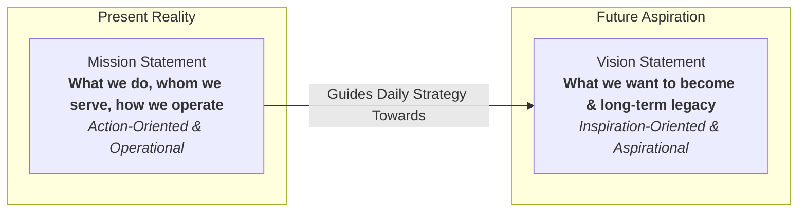
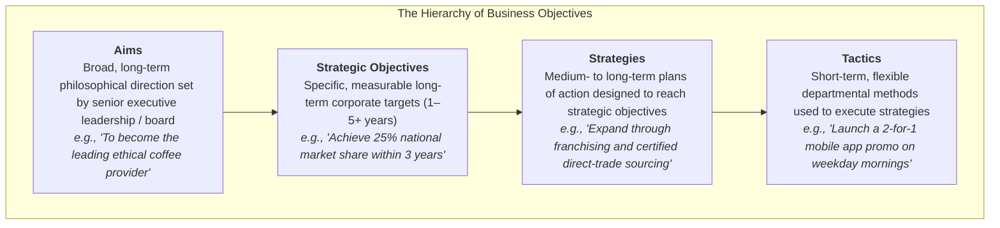
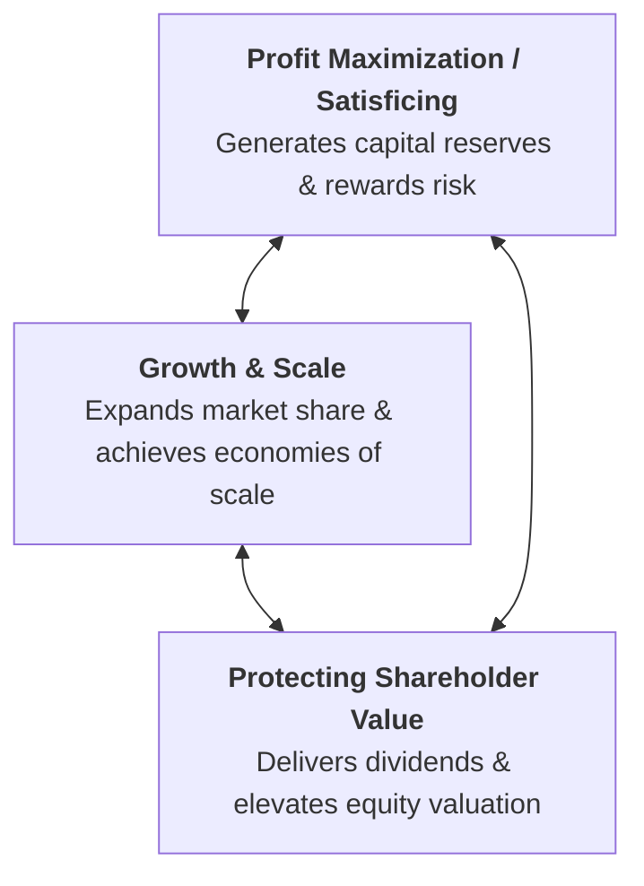
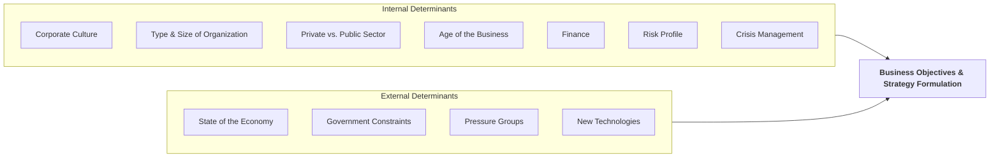
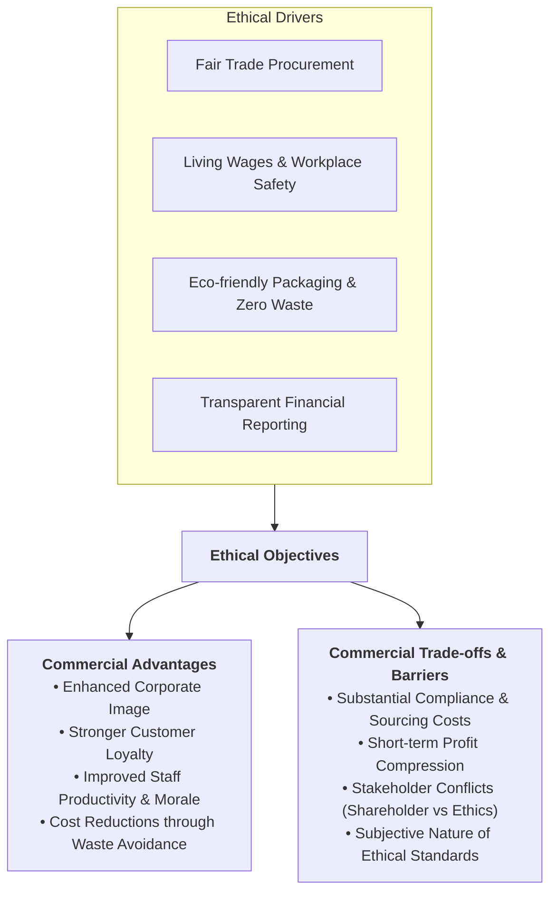
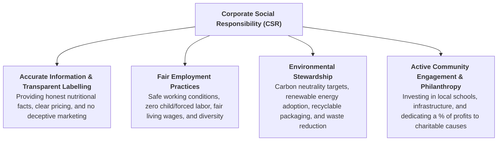

# 1.3 Business Objectives

> **IB Business Management | Unit 1: Business Organization and Environment**  
> **Topic:** 1.3 Business Objectives (SL/HL Core)

---

## 1. Vision and Mission Statements

Vision and mission statements form the philosophical foundation of any organization. They articulate an organization's core identity, establishing why it exists today and where it aspires to be in the future.

### Mission Statement

* **Definition & Purpose:** A formal declaration that describes an organization's current purpose, its fundamental reason for existence, and the distinct value it provides to customers, employees, and society.
* **Temporal Focus:** Anchored strictly in the **present**—what the organization does now, whom it serves, and the tangible methods it employs to deliver value.
* **Tone & Orientation:** **Action-oriented** and pragmatic. It outlines concrete goals, core operational practices, and the company's direct approach to satisfying stakeholder needs.
* **Student Notes Reference Example:**
  > *"To provide high-quality, affordable healthcare products to improve the well-being of our customers."*

### Vision Statement

* **Definition & Purpose:** A forward-looking declaration outlining the desired future state, long-term aspirations, and ultimate destiny of the organization. It paints a picture of what the business hopes to achieve or become over an extended time horizon.
* **Temporal Focus:** Anchored firmly in the **future**—where the business is heading and what ultimate legacy it seeks to accomplish.
* **Tone & Orientation:** **Inspiration-oriented** and motivational. It serves to excite, challenge, and inspire internal employees and external stakeholders.
* **Student Notes Reference Example:**
  > *"To be the global leader in sustainable healthcare solutions."*

### Comparative Analysis: Mission vs. Vision

| Dimension | Mission Statement | Vision Statement |
| :--- | :--- | :--- |
| **Core Question** | *"What is our business and what do we do today?"* | *"What do we want to become in the future?"* |
| **Temporal Focus** | Can focus on the immediate time period; no distinct time frame (p.39). | The very long term (the distant future). |
| **Tone** | Clear and practical; sets out core values; qualitative rather than quantitative (p.39). | Inspirational, visionary, ambitious, motivational. |
| **Primary Audience** | Current employees, immediate customers, operational partners. | Strategic leaders, future talent, investors, community. |
| **Change Frequency** | Updated more frequently than vision statements (p.40). | Changes less often; focuses on the very long term. |
| **Failure Risk** | Cynicism if daily operations contradict the stated mission. | Disillusionment if the vision is perceived as purely fictional. |

### Real-World Corporate Examples

*(Company statements below are not from the textbook, except Google's mission, which appears in Question 3.1. Textbook examples: Adidas's vision 'To be the leading sports brand in the world' (p.39); Question 3.1 lists BMW, Coca-Cola, Google, Häagen-Dazs, Lego, Microsoft, Oxfam and Walt Disney Company.)*

* **Nike:**
  * *Mission:* *"Bring inspiration and innovation to every athlete* in the world (*if you have a body, you are an athlete)."*
  * *Vision:* *"To remain the most authentic, connected, and distinctive brand in sport culture."*
* **Tesla:**
  * *Mission:* *"To accelerate the world's transition to sustainable energy."*
  * *Vision:* *"To create the most compelling car company of the 21st century by driving the world's transition to electric vehicles."*
* **Google (Alphabet):**
  * *Mission:* *"To organize the world's information and make it universally accessible and useful."*
  * *Vision:* *"To provide access to the world's information in one click."*

---

## 2. Business and Organizational Objectives

### What are Business Objectives?

**Business objectives** (or organizational objectives) are the specific, quantifiable targets and measurable goals that an organization strives to achieve within a given timeframe, formulated strictly in line with its overarching mission statement. 

> [!IMPORTANT]
> Without clear objectives, a business has no unified sense of direction, lacks criteria for evaluating success, and risks operational drift where departments work at cross-purposes.

### Three Reasons Business Objectives Are Important

Objectives are the goals or targets an organization strives to achieve. Without clear objectives, an organization has no real sense of direction or purpose. Objectives are important for three reasons:

1. **To measure and control:**
   * Business objectives help to control a firm's plans, as they determine the parameters for business activity.
   * Objectives provide the basis for measuring and controlling the performance of the business as a whole.
2. **To motivate:**
   * Objectives can inspire managers and employees to reach a common goal, which helps to unify and motivate the workforce.
   * They encourage managers to think strategically, that is, to plan for the long-term success of the business.
3. **To direct:**
   * Objectives provide an agreed and clear focus (or sense of purpose) for all individuals and departments of an organization.
   * As the foundation for decision-making, objectives are used to devise appropriate business strategies.

---

## 3. The Hierarchy of Objectives (beyond the textbook)

> [!NOTE]
> The aims hierarchy and the SMART criteria are common IB teaching, but they are **not covered in the Hoang textbook's Unit 1.3 chapter** (pp.39-52). The textbook's own terms are strategic objectives, tactical objectives, strategies (medium- to long-term plans of action) and tactics (short-term methods). Roles, time spans and examples in this section are illustrative.

Organizational decision-making is structured hierarchically. Broad aspirations at the top filter down into increasingly granular, time-bound targets and operational routines at lower levels.

### Granular Breakdown of Hierarchy Tiers

1. **Aims:**
   * General, long-term statements of purpose and overall philosophy.
   * Typically qualitative rather than quantitative (e.g., *"To deliver exceptional value and promote environmental sustainability"*).
   * Formulated by the Board of Directors and senior executive management.
2. **Strategic Objectives:**
   * Specific, measurable, and time-bound goals that translate broad aims into workable benchmarks.
   * Cover the entire organization over a medium to long-term horizon (typically 3 to 5 years).
   * Examples include targeted market share growth, return on capital employed (ROCE), or revenue milestones.
3. **Strategies:**
   * The comprehensive plans of action and major operational commitments formulated to realize strategic objectives.
   * Medium to long-term in scope, requiring substantial capital investment and senior management coordination.
4. **Tactics:**
   * Short-term, concrete operational methods and routines designed to implement strategies on a daily, weekly, or monthly basis.
   * Confined to specific departments, functional sections, or local branches of the organization.
   * Highly adaptable and responsive to immediate competitor moves or local conditions.

### The SMART Criteria for Objectives

To be effective, organizational objectives should satisfy the **SMART** framework:

* **S – Specific:** Unambiguous and focused on a clearly defined outcome (e.g., *"Increase sales of electric bicycles"* rather than *"Do better in sales"*).
* **M – Measurable:** Quantified using numerical metrics or financial KPIs (e.g., *"by 15%"*).
* **A – Achievable / Agreed:** Realistic enough to avoid demoralizing staff, agreed upon by both management and team members.
* **R – Realistic / Relevant:** Feasible given the firm's financial, human, and technological resources, and aligned with overall corporate aims.
* **T – Time-bound:** Bounded by an explicit deadline or completion schedule (e.g., *"by Q4 2027"*).

---

## 4. Strategic vs. Tactical Objectives

A fundamental distinction in IB Business Management is the contrast between long-term strategic objectives and immediate tactical objectives.

| Dimension | Strategic Objectives | Tactical Objectives |
| :--- | :--- | :--- |
| **Time Horizon** | The longer-term goals of a business (p.45). | Short term: targets for the next 12 months or sooner (p.45). |
| **Organizational Scope** | The organization as a whole. | Affect a section (key term: a unit) of the organization; guide the daily functioning of certain departments or operations. |
| **Achieved Through** | Strategies: medium- to long-term plans of action. | Tactics: short-term methods. |
| **Textbook Examples** | • **Profit maximization** and **growth**. • **Market Standing:** presence in the industry. • **Image and Reputation:** building public goodwill. • **Market Share:** sales revenue as a percentage of industry sales. | • **Survival:** start-ups, recessions, takeover targets. • **Sales Revenue Maximization:** establishing a new business. • Raising sales revenue of a product line by $10m within the next year. • Keeping staff turnover below 10%. |

### Case Distinction: Survival as Tactical vs. Strategic

> [!NOTE]
> The textbook classes **survival as a tactical objective** (p.45): for new businesses facing problems such as a lack of brand recognition, during an economic recession, and when a business becomes a takeover target. However, p.46 also says survival can become a key **strategic** objective if a firm is threatened by a hostile takeover, so the textbook is not fully consistent. Default to 'tactical' and, where relevant, note that a hostile takeover threat can make survival strategic.

---

## 5. Core Business Objectives

The syllabus lists four common business objectives (AO3): (i) growth, (ii) profit, (iii) protecting shareholder value and (iv) ethical objectives. The first three are covered here; ethical objectives are covered in section 7.

### 1. Profit
* **Nature:** The primary financial engine and standard measure of performance for private sector enterprises.
* **Role in Entrepreneurship:** Profit serves as the necessary financial return that compensates entrepreneurs and investors for bearing capital risk.
* **Maximization vs. Satisficing:**
  * *Profit Maximization:* Striving to generate the highest possible financial surplus; traditionally the main objective of most private sector organizations (p.42).
  * *Profit Satisficing (not in the Hoang textbook):* Aiming for a level of profit that satisfies shareholders' dividend expectations while allowing leadership to pursue other goals (such as ethical procurement, employee welfare, or environmental protection).

### 2. Growth
* **Nature:** The expansion of an organization's operating scale, measured through sales revenue, volume output, customer numbers, or market share.
* **Strategic Necessity:** Essential for long-term commercial survival. Stagnant businesses are vulnerable to aggressive competitors who capture consumer attention and gain market power.
* **Benefits of Growth:**
  * Unlocks internal **economies of scale** (purchasing, managerial, financial, technical), lowering average unit costs ($ATC$).
  * Increases bargaining power over suppliers and distributors.
  * Elevates brand awareness, defensive resilience, and pricing leverage.

### 3. Protecting and Maximizing Shareholder Value
* **Nature:** Generating sustainable, long-term financial wealth for the legal equity owners (shareholders) of an incorporated enterprise.
* **Mechanisms of Value Creation:**
  * **Dividend Yields:** Distributing a portion of retained net profits to shareholders as periodic cash payments.
  * **Capital Appreciation:** Elevating the company's market capitalization and stock price through consistent earnings growth and strategic positioning.
* **Time Horizon Balance:** Modern governance requires boards to protect shareholder value over the long run rather than boosting short-term earnings at the expense of vital R&D or ethical integrity.

---

## 6. Factors Determining & Affecting Business Objectives

Business objectives do not exist in a vacuum. They are continuously shaped, constrained, and modified by internal dynamics and external forces.

### Internal Factors (textbook p.50: within the organization's control)

1. **Corporate Culture:**
   * The accepted norms and customs of an organization. Firms with a flexible, adaptable culture are more likely to have creative objectives that change over time.
2. **Type and Size of Organization:**
   * Any change in legal status is likely to change objectives. Where ownership and control are separate (e.g. publicly held companies), managerial objectives (such as higher bonuses) and shareholder objectives (such as higher dividends) must both be considered.
3. **Private versus Public Sector:**
   * Unlike most private sector firms, most public sector organizations do not aim to maximize profit but to provide a service to the general public.
4. **Age of the Business:**
   * Newly established firms tend to make **survival** their key objective, while established businesses might aim for **growth and higher market share**.
5. **Finance:**
   * The amount of finance available determines the scope of a firm's objectives; e.g. expanding into overseas markets needs a huge sum of money.
6. **Risk Profile:**
   * If managers and entrepreneurs are relatively willing and able to take risks, more ambitious objectives are likely, e.g. diversification into new markets with new products.
7. **Crisis Management:**
   * Internal crises such as unexpectedly high absenteeism and labour turnover, falling productivity and motivation, liquidity problems, or quality-standard issues.

### External Factors (textbook pp.50-51: beyond the organization's control)

1. **State of the Economy:**
   * An economic boom creates many opportunities, while a recession (high unemployment, low consumption) can threaten survival.
2. **Government Constraints:**
   * Rules and regulations limit what a business can aim for; e.g. environmental protection laws can limit profit maximization because compliance costs more.
3. **The Presence and Power of Pressure Groups:**
   * e.g. environmental groups can force a business to review its approach to ethics through lobbying, and can harm the corporate image of a business that is not socially responsible.
4. **New Technologies:**
   * New technologies and creativity generate business opportunities and so change objectives, e.g. Samsung exploited digital technologies to dominate the smartphone and smart TV industries, and e-commerce has revolutionised how most businesses operate.

*(The textbook does not frame these as a STEEPLE list. Leadership style, social trends and competitor actions are not among the factors it lists.)*

---

## 7. Ethical Objectives

### What are Ethical Objectives?

**Ethical objectives** are organizational goals and targets grounded in the **moral principles** that guide decision-making and business strategy. Business ethics define the actions and behaviors that organizations consider to be morally right, fair, and just, transcending mere compliance with minimum legal mandates.

### Advantages of Setting Ethical Objectives

1. **Enhanced Corporate Image and Brand Equity:**
   * Modern consumers gravitate toward brands perceived as fair, honest, and socially conscious. A verified ethical track record serves as a powerful unique selling point (USP).
2. **Increased Customer Loyalty:**
   * Consumers are willing to remain loyal to businesses that uphold strong moral stances (e.g., The Body Shop built a large worldwide customer base on its policy of not testing products on animals, textbook Table 3.1).
3. **Cost Reductions through Sustainable Practices:**
   * Minimizing packaging, cutting toxic emissions, conserving water, and improving energy efficiency directly lower operational overhead and eliminate waste.
4. **Improved Employee Productivity, Motivation, and Loyalty:**
   * High ethical standards foster workplace pride. Qualified talent is easier to recruit and retain, lowering expensive labor turnover and absenteeism while elevating daily engagement.
5. **Mitigation of Legal and Regulatory Risks:**
   * Proactive ethics shield the business from costly civil lawsuits, regulatory penalties, investigative media exposés, and consumer boycotts.

### Disadvantages, Trade-offs, and Implementation Barriers

1. **High Compliance and Procurement Costs:**
   * Compliance costs can be very high; e.g. producing organic agricultural products is far more expensive than growing GM crops (textbook Table 3.1).
2. **Lower Profits:**
   * If compliance costs cannot be passed on as higher prices, profitability is likely to fall; an ethical dilemma arises when the ethical choice is less profitable.
3. **Stakeholder Conflicts:**
   * Classic agency dilemma: Institutional shareholders demanding immediate quarterly dividends may oppose expensive ethical capital outlays, viewing social expenditures as a diversion of capital.
4. **Subjective Nature of Business Ethics:**
   * What is considered morally virtuous in one country or culture may be regarded as neutral, unnecessary, or unacceptable in another. Defining an absolute moral standard across global supply chains creates operational ambiguity.
5. **Risk of Greenwashing Allegations (not in the Hoang textbook):**
   * If a business markets ethical claims that are later discovered to be overstated or misleading, the resulting reputational backlash can be far more catastrophic than if no claims had been made at all.

---

## 8. Corporate Social Responsibility (CSR)

### What is Corporate Social Responsibility?

**Corporate Social Responsibility (CSR)** is the conscientious consideration of ethical and environmental practice related to business activity (textbook p.47 and key term p.52). A business that adopts CSR acts morally towards all of its stakeholder groups and the well-being of society as a whole. The syllabus sets CSR at AO2.

> [!NOTE]
> Ethical objectives are the explicit operational goals that a business sets to integrate CSR into its commercial DNA and day-to-day business model.

### Core Dimensions and Practical Examples of CSR

1. **Accurate Information and Transparent Labelling:**
   * Providing consumers with genuine, verifiable product details without deceptive marketing or hidden fees (e.g., clearly disclosing allergens, nutritional contents, and true environmental footprints).
2. **Fair Employment Practices:**
   * Safeguarding employee physical and mental well-being, enforcing fair grievance procedures, ensuring equal pay for equal work, and auditing global Tier-1 and Tier-2 suppliers to stamp out forced labor.
3. **Environmental Considerations:**
   * Measuring and curbing greenhouse gas emissions, adopting circular packaging systems, phasing out non-biodegradable plastics, and protecting regional biodiversity.
4. **Active Community Engagement and Philanthropy:**
   * Sponsoring civic initiatives, funding educational workshops in underrepresented areas, providing disaster relief, and encouraging employee volunteerism during paid hours.

### External Pressures Driving CSR Adoption

* **Pervasive Media Exposure & Digital Scrutiny:**
   * 24/7 global news cycles, smartphone cameras, and social media platforms mean corporate missteps are instantly broadcast worldwide. Large multinational corporations ($MNCs$) face societal expectations to act as benevolent global citizens and donate portions of profits to public welfare causes.
* **Ethical Consumerism and Boycott Movements:**
   * Consumers actively research supply chain ethics. Boycotts against sweatshops, animal testing, and deforestation can wipe out millions in market value within days.
* **Investor Wariness:**
   * Investors are warier of putting money into unethical firms, e.g. those using child labour (textbook p.47). *(ESG investment scores are not discussed in the Hoang textbook.)*
* **Pressure Groups and Climate Change:**
   * Through pressure group action and education, climate change and environmental damage have become huge concerns, so businesses are changing their objectives to reflect their part in protecting the planet.

### Barriers to Fulfilling CSR Commitments

* **Financial and Capital Constraints:** High capital outlay required for renewable plant upgrades, sustainable supply chain restructuring, and audit systems.
* **Shareholder Resistance to Profit Diversion:** Pressure for immediate quarterly dividends can discourage long-term societal investments.
* **Macroeconomic Hardships:** During economic recessions or sharp cost crises, CSR initiatives are frequently the first programs defunded in an effort to maintain solvency.
* **Global Supply Chain Complexity:** Monitoring hundreds of sub-tier overseas contractors creates severe enforcement and verification bottlenecks.

---

## 9. Syllabus Summary Checklist & Review

| Concept | Key Exam Takeaway |
| :--- | :--- |
| **Mission Statement** | The declaration of an organization's overall purpose; forms the foundation for setting objectives (key term, p.52). Qualitative, no distinct time frame. (AO2) |
| **Vision Statement** | An organization's long-term aspirations, i.e. where the business ultimately wants to be (key term, p.52). (AO2) |
| **Hierarchy of Objectives** | Aims $\rightarrow$ Strategic Objectives $\rightarrow$ Strategies $\rightarrow$ Tactics. *(Not in the Hoang textbook.)* |
| **SMART Framework** | Objectives must be Specific, Measurable, Achievable, Realistic, and Time-bound. *(Not in the Hoang textbook.)* |
| **Strategic vs. Tactical** | Strategic: longer-term goals of the whole business; Tactical: short-term (next 12 months or sooner), affecting a section of the organization. (AO3) |
| **Core Objectives** | Growth, profit, protecting shareholder value and ethical objectives. (AO3) |
| **Internal & External Determinants** | Internal: culture, type and size, private vs public sector, age, finance, risk profile, crisis management. External: state of the economy, government constraints, pressure groups, new technologies. |
| **Ethical Objectives** | Moral guidelines beyond statutory law; enhances brand loyalty and morale, but raises direct operating costs and triggers stakeholder friction. |
| **Corporate Social Responsibility (CSR)** | The conscientious consideration of ethical and environmental practice related to business activity (key term, p.52). (AO2) |
