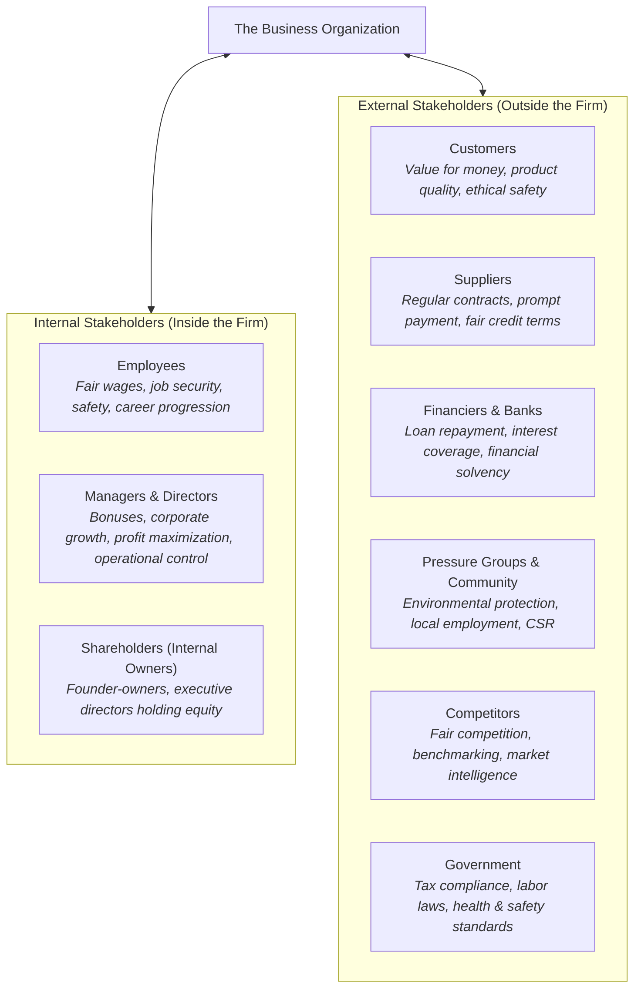
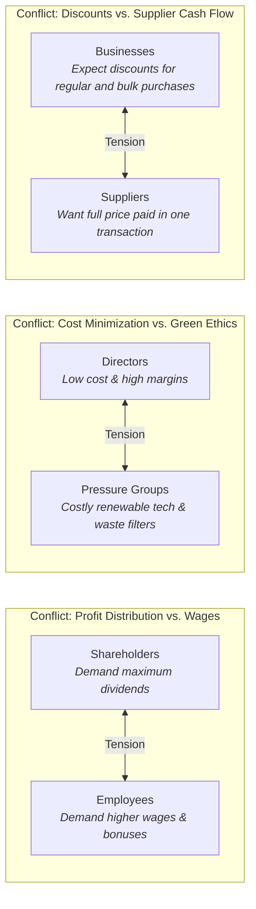

# 1.4 Stakeholders

> **IB Business Management | Unit 1: Business Organization and Environment**  
> **Topic:** 1.4 Stakeholders (SL/HL Core)  
> **Depth of Teaching:** AO2 Application & Analysis

---

## 1. Stakeholder Concept & Core Distinctions

The word **"stake"** signifies having an interest, a financial investment, or being directly involved in and impacted by something. 

### What is a Stakeholder?
A **stakeholder** is any individual, group, or organization with a direct interest or involvement in the operations, decisions, and overall performance of a business. Stakeholders are intrinsically impacted by organizational activities and, conversely, possess varying degrees of influence over business conduct.



---

### Critical IB Distinction: Stakeholders vs. Shareholders

> [!WARNING]
> **Most Common IB Exam Mistake:** Many students use the terms *stakeholders* and *shareholders* interchangeably. They are fundamentally different concepts!

| Dimension | Stakeholders | Shareholders (Stockholders) |
| :--- | :--- | :--- |
| **Definition** | **Any** individual, group, or entity with an interest in, or affected by, business operations. | An individual or institution that legally **owns shares** of capital in a limited liability company (private or public). |
| **Scope** | Broad umbrella category encompassing employees, customers, suppliers, government, community, and owners. | Specific, narrow subset of internal/external stakeholders representing legal equity owners. |
| **Voting Rights** | Generally no voting rights in corporate governance (unless they also hold voting shares). | Possess statutory voting rights at the Annual General Meeting (AGM) to elect the Board of Directors. |
| **Financial Reward** | Wages (employees), trade credit/revenue (suppliers), interest (banks), tax revenues (government). | **Dividends** (annual share of distributed net profit) and **Capital Gains** (increase in share market value). |
| **Logical Relationship** | **All shareholders are stakeholders, but NOT all stakeholders are shareholders.** | A distinct class of financial stakeholder exclusive to incorporated business entities. |

---

## 2. Internal Stakeholders

**Internal stakeholders** are members of the organization who operate from within the business entity:

### {i} Employees
* **Role & Nature:** The collective workforce producing goods, delivering services, and interacting directly with clients.
* **Core Interests & Objectives:**
  * Competitive financial remuneration (basic pay, overtime, performance-related bonuses).
  * Safe, ergonomic, and non-discriminatory working conditions.
  * Job security, fair employment contracts, and pensions.
  * Opportunities for training, career development, and internal promotion.
* **Theoretical Grounding:**
  * **Charles Handy** asserts that employees are an organization's most valuable asset.
  * **Fred Allen:** *"Treat employees like partners and they act as partners."*
  * **Sir Richard Branson:** puts his employees first, customers second and shareholders third, and claims that both customers and shareholders benefit as a result.
* **Industrial Friction Risk:** Demotivated or mistreated employees can initiate industrial action (strikes, go-slows, work-to-rule).
  * *Textbook Example:* In late 2013, around 40,000 BMW workers went on a prolonged labour strike at its South Africa car plant, causing export sales to fall by 75%.
  * *Textbook Example:* In 2019, a pilots' strike at British Airways cost the company €215 million ($245m) in lost earnings. (The textbook does not give the cause of either strike.)

### {ii} Managers and Directors
* **Role & Nature:**
  * **Managers:** Oversee day-to-day operations, lead departmental teams, and coordinate operational tasks.
  * **Directors:** Senior executives elected by shareholders to govern company operations on behalf of owners (forming the Board of Directors).
* **Core Interests & Objectives:**
  * Maximizing corporate profits to ensure operational continuity and justify executive bonuses.
  * Long-term strategic health, retaining earnings for research, development, and capacity expansion.
  * Maximizing their own benefits, such as annual bonuses and other financial rewards.
  * Profit maximization also pleases shareholders, which helps to safeguard the jobs of top executives.

### {iii} Shareholders (Owners)
* **Role & Nature:** Investors who purchase shares of equity in a limited liability company (Ltd or PLC).
* **Core Interests & Objectives:**
  * **Dividend Yield:** Regular distribution of after-tax corporate profits.
  * **Capital Gain:** Appreciation of share market price over time.
  * Exercising democratic voting power at AGMs to steer strategic trajectory.
* **Dual Nature Note:** Shareholders can be **internal** (e.g., founder-directors, worker-shareholders under employee share schemes) or **external** (institutional funds, individual retail investors without operational involvement).

---

## 3. External Stakeholders

**External stakeholders** are individuals and organizations that do not form part of the business itself, but have a direct interest in its conduct, performance, and ethical footprint:

### {i} Customers
* **Interests:** High quality, safe, reliable products; fair and competitive pricing; excellent customer service; ethical and sustainable corporate conduct.
* **Significance:** In competitive markets with low switching costs, customer loyalty dictates organizational survival. Sam Walton (co-founder of Walmart) argued that customers can simply choose to spend their money elsewhere, threatening the survival of a business. Bill Gates said that dissatisfied customers are the best source of learning for any business.

### {ii} Suppliers
* **Interests:** Regular contracts with clients at competitive prices, and customers paying outstanding bills on time (p.55). A good relationship can bring preferential credit terms (buy today, pay later).
* **Significance:** Reliable supplier relationships guarantee uninterrupted just-in-time delivery of components and raw materials. Preferential trade credit from supportive suppliers significantly strengthens a firm's working capital and liquidity.

### {iii} Financiers (Banks, Lenders, Business Angels)
* **Interests:** The borrower's ability to generate sufficient profits, repay debts and make regular interest payments; a long-term relationship so they can make subsequent loans (p.55).
* **Significance:** Commercial banks and angel investors inject essential debt and equity capital required for initial start-up, working capital, and long-term asset expansion.

### {iv} Pressure Groups and Local Community
* **Interests:**
  * **Pressure Groups:** Campaigning against ecological destruction, deforestation, animal cruelty, child labor exploitation, and carbon emissions (e.g., Greenpeace, Friends of the Earth, WWF).
  * **Local Community:** Local employment opportunities, infrastructure development, minimizing negative externalities (noise, air pollution, traffic congestion, litter), and corporate sponsorship of communal initiatives.
* **Significance:** Pressure groups leverage digital media campaigns and consumer boycotts to compel legislative change and ethical operational reforms.

### {v} Competitors
* **Interests:** Fair market conduct, observing antitrust/competition laws, benchmarking operational performance, monitoring rivals' innovations and marketing strategies.
* **Cross-Shareholding Dynamics:** In modern global industries, competitors frequently hold minority equity stakes in each other. For example, Cathay Pacific is partially owned by Air China (28.2%) and Qatar Airways (9.4%); Porsche holds over 31% in Audi.

### {vi} Government
* **Interests:**
  * Collection of statutory corporate income taxes and value-added taxes (VAT).
  * Strict compliance with employment legislation (minimum wage, anti-discrimination).
  * Enforcement of occupational health and safety standards.
  * Consumer protection compliance and antitrust regulation.
  * Economic growth, low unemployment, and national export generation.
* **Significance:** Governments can support business (lower interest rates and/or taxes, subsidised rent and tax concessions for MNCs, investment in roads and communications) or constrain it (the textbook says Microsoft 'was broken up into two smaller companies due to numerous lawsuits', p.57). Governments can also hold significant equity stakes in commercial enterprises (e.g., Albania owning 51% of Air Albania; Japan owning 53.4% of Tokyo Metro).

---

## 4. Stakeholder Conflict & Trade-offs

### The Inevitability of Stakeholder Conflict
**Stakeholder conflict** refers to irreconcilable differences in the varying needs, priorities, and objectives of different stakeholder groups. Because financial, physical, and executive resources are inherently finite, **it is impossible for a business to satisfy all stakeholder demands simultaneously.**



### Classic Sources of Stakeholder Conflict

| Stakeholder A | Stakeholder B | Nature of Conflict | Real-World Exam Vignette |
| :--- | :--- | :--- | :--- |
| **Shareholders** | **Employees** | **Profit Allocation:** High dividend payouts reduce the retained profit available for wage increases and staff welfare programs. | *Skoda Auto (2007):* in the year Skoda entered China as part of its growth strategy, its workforce in Europe went on strike over remuneration (Question 4.4). |
| **Shareholders & Employees** | **Directors / CEOs** | **Executive Remuneration:** Excessive executive bonuses and stock options are viewed as unjustified corporate greed that depresses staff wages and shareholder dividends. | In 2021 the Economic Policy Institute reported that CEOs of the top 350 US companies were paid **351 times** more than a typical worker. |
| **Management** | **Suppliers** | **Payment & Pricing:** Suppliers want corporate customers to pay the full price in one transaction to improve their cash flow, whereas businesses expect discounted prices for regular purchases and for buying in large quantities (p.58). | Long-haul airlines rely on catering suppliers; if there is a dispute, flights might have to be cancelled (p.55). |
| **Management** | **Local Community & Pressure Groups** | **Externalities vs. Growth:** Rapid plant expansion creates noise, traffic congestion, and carbon emissions, degrading the local quality of life despite creating some jobs. | Holiday destinations damaged by mass tourism infrastructure (litter, ecological harm). |
| **Customers** | **Shareholders** | **Pricing vs. Profit Margins:** Customers demand lower retail prices and higher product quality, whereas shareholders demand higher profit margins and cost-cutting. | Illustrative (not from the textbook): cutting customer service staff to raise profit margins. |

---

## 5. Strategic Conflict Resolution & Modern Stakeholder Theory

### The Mutual Benefits Paradigm (Win-Win Synergy)
While conflict is naturally occurring, modern business theory highlights the **mutual benefits** of fulfilling multiple stakeholder needs over the medium to long term:
* Fulfilling employee needs (training, living wages, supportive culture) generates high morale, lower absenteeism, and reduced labor turnover.
* Motivated employees craft superior quality products and deliver exceptional customer care.
* Delighted customers remain loyal, write glowing reviews, and recommend the brand, driving market share expansion.
* Expanded revenues and profit margins yield larger long-term dividend distributions for shareholders.
* The community prospers through job creation and corporate social investment.

> **Philosophical Synthesis:** Jack Ma (Alibaba) echoed this principle: *"Customers first, employees second, and shareholders third. If the customer is happy, the business is happy and the shareholders are happy."*

### Key Determinants of Stakeholder Priority
When trade-offs are unavoidable, executive decision-makers prioritize stakeholders based on three criteria:
1. **Type of Business Entity:** Partnership owners might regard customers as the key stakeholder group, while the local community could be the most important group for a charitable organization; a limited liability company is accountable to its shareholders (owners), so it has to give them priority (pp.58-59).
2. **Organizational Objectives & Life-Cycle Stage:** A business striving for rapid growth or turnaround will prioritize senior management's strategic plans and capital retention over short-term dividend payouts.
3. **Source and Degree of Stakeholder Power:** Customers have more power if the business sells in a mass market with plenty of substitutes; access to the media gives pressure groups greater power; a united workforce strengthens employees' influence through their trade union (p.59).

---

## 6. Stakeholder Mapping (Power-Interest Grid, Figure 4.3)

*(This grid is often attributed to Mendelow, but the Hoang textbook does not use that name. In the textbook's Figure 4.3, LOW power is the top row and HIGH power the bottom row; the chart below draws high power at the top, but the quadrant letters are the same: A = low power/low interest, B = low power/high interest, C = high power/low interest, D = high power/high interest.)*

**Stakeholder Mapping** is a strategic management tool that plots stakeholder groups along two axes: their **Level of Power (Influence)** and their **Level of Interest** in the organization's decisions.

```mermaid
quadrantChart
    title Stakeholder Mapping: Power-Interest Grid
    x-axis Low Interest --> High Interest
    y-axis Low Power --> High Power
    quadrant-1 Quadrant D: Key Stakeholders (Maximum Effort)
    quadrant-2 Quadrant C: Keep Satisfied
    quadrant-3 Quadrant A: Minimum Effort
    quadrant-4 Quadrant B: Keep Informed
    "Small Retail Shareholder": [0.85, 0.2]
    "Local Residents (Small Facility)": [0.25, 0.15]
    "Institutional Mega-Investor": [0.88, 0.85]
    "Gov. Health & Safety Regulator": [0.22, 0.88]
    "Key Parts Supplier": [0.75, 0.72]
    "National Trade Union": [0.82, 0.80]
```

### The Four Quadrants & Strategic Engagement Protocols

```
                      LEVEL OF INTEREST
                     Low             High
              +---------------+---------------+
         Low  |  QUADRANT A   |  QUADRANT B   |
  POWER       | Minimum Effort| Keep Informed |
  LEVEL       +---------------+---------------+
         High |  QUADRANT C   |  QUADRANT D   |
              | Keep Satisfied|Maximum Effort |
              |               |               |
              +---------------+---------------+
```

### 1. Quadrant A: Low Power, Low Interest $\rightarrow$ Minimum Effort
* **Characteristics:** Possess neither significant influence over corporate operations nor high active interest in strategic decisions.
* **Examples:** Passive local residents living far from commercial operations, casual customers purchasing low-involvement convenience goods, small peripheral contractors.
* **Engagement Protocol:** Allocate minimal organizational resources; monitor periodically to ensure power or interest does not suddenly escalate.

### 2. Quadrant B: Low Power, High Interest $\rightarrow$ Keep Informed
* **Characteristics:** Deeply invested in and impacted by organizational decisions, but lack formal executive power or legal voting authority to dictate policy.
* **Examples:** Factory assembly-line workers without union backing, local community residents directly adjacent to a proposed development, environmental pressure groups with niche followings, minority retail shareholders.
* **Engagement Protocol:** Maintain transparent communication channels, newsletters, regular town halls, and informational consultations. Fostering goodwill prevents them from organizing to build collective power (e.g., through media lobbying).

### 3. Quadrant C: High Power, Low Interest $\rightarrow$ Keep Satisfied
* **Characteristics:** Wield tremendous legal, financial, or regulatory authority to halt or alter business activity, but remain largely indifferent to daily operations unless provoked.
* **Examples:** National tax authorities, environmental protection agencies, institutional commercial banks providing credit facilities, local municipal licensing boards.
* **Engagement Protocol:** Strictly observe all statutory laws, maintain debt covenants, fulfill financial liabilities on time, and ensure compliance to prevent these powerful entities from intervening actively.

### 4. Quadrant D: High Power, High Interest $\rightarrow$ Key Stakeholders (Maximum Effort)
* **Characteristics:** Crucial stakeholders whose active buy-in, collaboration, and satisfaction are imperative to corporate survival and strategic execution.
* **Examples:** Majority equity shareholders, executive directors, major labor unions representing critical technical staff, key single-source component suppliers, anchor customers providing 40%+ of corporate revenue.
* **Engagement Protocol:** Full collaboration, direct inclusion in decision-making processes, tailored executive consultations, and highest prioritization of resource allocation.

---

## 7. Textbook Case Study Syntheses

### Question 4.1: Nokia & Microsoft (2013)
* **Context:** Nokia was market leader in mobile phones from 1998 to 2008, with up to 49.4% market share. Apple and Samsung smartphones forced Nokia to be sold to Microsoft for €5.4 billion ($7.3bn) in November 2013, after its share price had dropped by 93% and its market share had fallen to only 3%. 99.5% of Nokia's 3,900 shareholders voted in favour.
* **Stakeholder Impact (textbook facts only):**
  * *Shareholders:* voted overwhelmingly (99.5%) in favour of the sale.
  * *Employees:* the 32,000 employees in the mobile phones division were transferred to Microsoft Mobile in early 2014.
  * The question asks students to examine how other stakeholder groups were affected; the textbook gives no further facts.

### Question 4.4: Skoda Auto (2007)
* **Context:** Skoda Auto, founded in 1895, became part of the Volkswagen Group in 2000. In early 2007 it entered China as part of its growth strategy, and in the same year its workforce in Europe went on strike over remuneration.
* **Stakeholder Conflict:** The industrial action cost Skoda, the country's largest exporter, 60 million crowns ($2.9m) per day in lost output.
* **Outcome:** China became Skoda's main market; by 2013 it had produced its 1 millionth car in China, and one in four Skoda cars is sold in China. (The textbook does not say how the strike was resolved.)

---

## 8. High-Yield Glossary Terms

1. **Stakeholder:** Any individual, group, or organization with a direct interest or involvement in the operations and performance of a business.
2. **Internal Stakeholders:** Members of the business entity who operate from within, specifically employees, managers, directors, and internal owners.
3. **External Stakeholders:** Individuals and organizations outside the business that have a direct interest in its operations, including customers, suppliers, financiers, competitors, pressure groups, and government.
4. **Shareholder (Stockholder):** An individual or institution that legally owns equity shares in a limited liability company, entitled to voting rights and financial dividends.
5. **Stakeholder Conflict:** The inevitable friction and disagreement arising from the incompatible needs, priorities, and objectives of different stakeholder groups.
6. **Stakeholder Mapping:** A model that assesses the relative interest of stakeholders and their relative influence (or power) on an organization (key term, p.64).
7. **Remuneration:** Pay and benefits (the textbook's gloss, p.58), e.g. basic salary, overtime pay, bonuses and other benefits.
8. **Pressure Group:** A special-interest organization of individuals seeking to influence business decisions, public opinion, and government legislation regarding specific causes (e.g., environmental protection).
9. **Financiers:** Financial institutions (commercial banks) and private investors (business angels) that provide debt or equity capital to an enterprise in return for interest or dividends.
10. **Mutual Benefits (Synergy):** The idea in modern management thinking that meeting the needs of employees and customers can lead to greater long-term profits that please shareholders and may create local employment, although this might only occur in the medium to long term (p.60).
