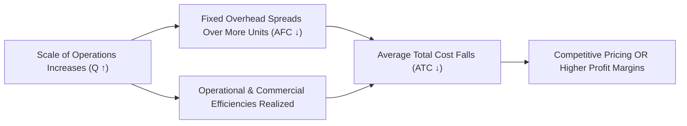
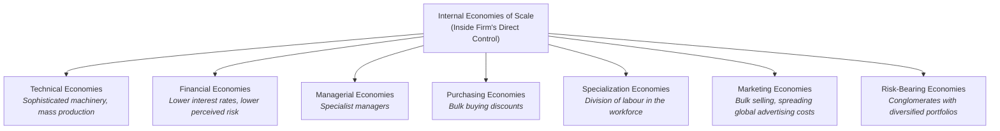
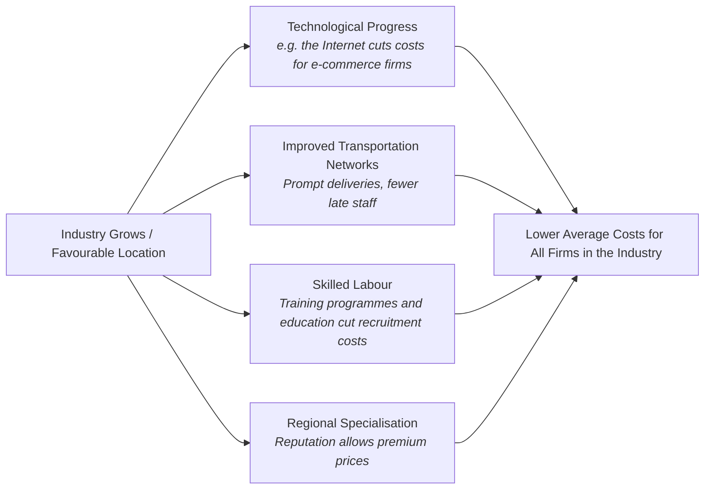
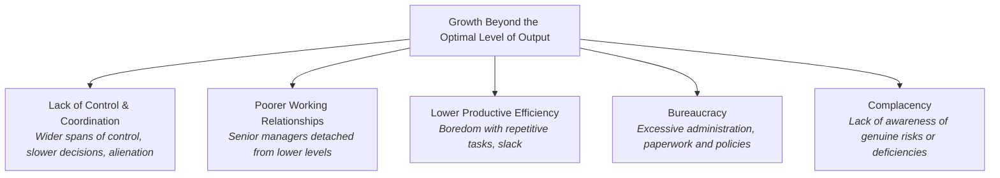

# 1.5 Growth and Evolution: Economies and Diseconomies of Scale

> **IB Business Management | Unit 1: Business Organization and Environment**  
> **Topic:** 1.5 Growth and Evolution — Economies & Diseconomies of Scale (SL/HL Core)  
> **Depth of Teaching:** AO2 for internal and external economies and diseconomies of scale and for internal vs external growth; AO3 for reasons to grow, reasons to stay small and external growth methods (IB syllabus table, textbook p.65)

---

## 1. Core Concepts & Microeconomic Foundations

### What is Scale of Production?
In business economics, **scale of production** refers to the overall size or operational capacity of an enterprise's physical output facilities. 

* **Scale** denotes long-run productive capacity (factories, machinery, aircraft fleet, retail store network).
* **Growth** refers to the process of an organization increasing its size, market share, revenue, or output volume over time.

### The Fundamental Law of Economies of Scale
**Economies of scale** refers to lower average costs of production (cost per unit) as a firm operates on a larger scale, due to an improvement in its productive efficiency (textbook p.65).

Average cost (AC) is the cost per unit of output: AC = TC ÷ Q. For example, if the total cost of producing 10,000 shirts is $78,000, each shirt costs $7.80. AC is made up of average fixed costs (AFC = TFC ÷ Q) and average variable costs (AVC = TVC ÷ Q). AFC declines continuously as output rises, because the same total fixed cost is spread over more units.

> **Average Total Cost (ATC):** `ATC = Total Cost (TC) / Quantity of Output (Q) = Average Fixed Cost (AFC) + Average Variable Cost (AVC)`



> [!WARNING]
> **#1 Trap in Unit 1.5:** Economies of scale is **NOT** simply "total costs getting cheaper." As output expands, **Total Cost (TC) usually increases**. Economies of scale means **average cost per unit** decreases, so always say "per unit" or "average cost" in a definition.

---

## 2. The Average Cost Curve & the Optimal Level of Output

The textbook's Figure 5.1 shows a single U-shaped curve labelled "Average costs", with costs ($) on the vertical axis and output on the horizontal axis. (Economics texts often call this the long-run average cost (LRAC) curve and use the term "minimum efficient scale"; the Hoang textbook uses neither term.)

```
Costs ($)
  ^
  |\                                            /
  | \    Economies of scale                    /   Diseconomies of scale
  |  \   (average costs fall)                 /    (average costs rise)
  |   \                                      /
  |    \                                    /
  |     ` - - . _                  _ . - - '
  |              ` - - - - - - - -'
  |                      :
  +----------------------:-------------------------------------> Output
               Optimal level of output
              (average costs minimised)
```

### Key Milestones:
1. **Economies of scale:** as the firm operates on a larger scale, average costs fall up to the optimal level of output.
2. **Optimal level of output:** the most efficient scale of operation, where average costs are minimised.
3. **Diseconomies of scale:** further increases in output beyond the optimal level bring higher average costs.

---

## 3. Internal Economies of Scale (The 7 Core Drivers)

**Internal economies of scale** are cost-saving efficiencies that arise **inside** an individual firm from its own operational expansion, within its control (textbook p.66).



Mnemonic for all seven: **"Really Fun Mums Try Making Super Pies"** (Risk-bearing, Financial, Managerial, Technical, Marketing, Specialization, Purchasing).

| Type of Internal Economy | Mechanism (textbook p.66-67) | Textbook Example |
| :--- | :--- | :--- |
| **Technical Economies** | Large firms use sophisticated capital and machinery to mass produce, spreading high fixed costs over a huge scale of output. Small businesses do not find such technology feasible or cost-efficient. | **Philips** factory in Shenzhen, China, produces complete audio systems within a few seconds. |
| **Financial Economies** | Large firms can borrow large sums at lower rates of interest because lenders see them as less risky; financiers compete to lend to large, reputable businesses. Smaller firms struggle to raise external finance and pay higher interest. | No named firm in the textbook. |
| **Managerial Economies** | Large firms divide managerial roles by employing specialist managers, avoiding duplication of effort in planning, communication, marketing, distribution and production. A sole trader often has to be marketer, accountant and production manager. | Sole trader vs large firm contrast. |
| **Specialization Economies** | Division of labour: specialist designers, production staff, engineers and marketers each handle one part of the production process, raising productivity and reducing the average cost of output. This is similar to managerial economies but comes from the workforce rather than management. | **Motor vehicle manufacturers** using mass production techniques |
| **Purchasing Economies** | Large firms lower average costs by buying resources in bulk. Even relatively small firms get bulk discounts, but the larger the order, the greater the discount might be. | No named firm in the textbook. |
| **Marketing Economies** | Large firms sell in bulk, saving time and transaction costs, and spread advertising costs by using the same campaign across the world. | **Coca-Cola** can sell 1,000 cans in one transaction to a supermarket, whereas a small retailer might sell 1,000 cans in a month to hundreds of customers. **McDonald's and Nike** use the same global campaigns; translation is a minor part of the cost. |
| **Risk-Bearing Economies** | Conglomerates (firms with a diversified portfolio of products in different markets) spread fixed costs such as advertising or R&D across a wide range of operations, so a loss in one area does not jeopardise the business overall. | **Reliance Industries** (India): energy, financial services, logistics, mass media, natural gas, petrochemicals, retail, telecommunications and textiles. |

> **Common mistake (textbook p.67):** economies of scale are not "the benefits of bulk buying", because even small businesses can buy in bulk. Financial, technological and managerial economies are probably far more important in reducing average costs for most businesses.

---

## 4. External Economies of Scale

**External economies of scale** are cost-saving benefits of large-scale operations that arise from **outside** the business, due to its favourable location or general growth in the industry. Other firms within the industry also enjoy them, and they are generally beyond an individual firm's control (textbook pp.66-68).



* **Technological progress:** increases productivity within the industry. The Internet has created huge cost savings for e-commerce businesses, which do not have to locate in central business districts and so avoid highly expensive rents.
* **Improved transportation networks:** help ensure prompt deliveries. Employees who are late because of poor transport links cost the business money; congestion and inefficiencies raise costs and reduce profits.
* **Skilled labour:** an abundance of skilled labour in the local area (for example from government-aided training programmes or reputable education facilities) cuts recruitment and training costs without compromising productivity.
* **Regional specialisation:** a location has a highly regarded reputation for a certain good or service. Murano, in Venice, Italy, is famous for glass products such as vases, jewellery and chandeliers, and its reputation lets Murano firms charge premium prices.

---

## 5. Internal Diseconomies of Scale

When an organization grows beyond its optimal level of output, average costs rise. Internal diseconomies of scale usually occur due to problems of mismanagement (textbook p.68).



### The 5 Internal Diseconomy Mechanisms (textbook p.68):
1. **Lack of control and coordination:** the span of control is likely to increase, causing communication problems and slower decision-making. Coordination problems arise with operations in different locations, and workers may feel alienated, harming morale.
2. **Poorer working relationships:** senior managers become detached from those lower down the hierarchy, damaging communication flows and motivation.
3. **Lower productive efficiency:** specialization and division of labour can bore workers with repetitive tasks and create scope for slack (inefficiencies and procrastination).
4. **Bureaucracy:** excessive administration, paperwork and company policies make decision-making more time-consuming and add to costs without a proportional rise in output.
5. **Complacency:** a large, dominant firm or market leader may lack awareness of genuine risks or deficiencies, which reduces productivity and raises unit costs.

> Because of potential diseconomies, some businesses prefer to grow via franchising: McDonald's and 7-Eleven used it to expand and raise brand awareness without facing the higher average costs of being large.

---

## 6. External Diseconomies of Scale

**External diseconomies of scale** occur when the average cost of production increases as a firm grows, due to factors beyond its control. They affect the whole industry, often because there are just too many firms competing in the market (textbook p.69). The textbook gives three causes:

* **Higher rents:** too many businesses locating in an area makes land scarcer, raising rents and fixed costs. High demand to locate in Manhattan (New York City), Shinjuku (Tokyo), The City (London) and Silicon Valley (San Francisco) has caused a sustained rise in land rental values.
* **Higher pay and financial rewards:** workers have a greater choice of employers, so businesses may have to pay more to retain or attract staff, raising costs without necessarily raising output.
* **Traffic congestion:** too many businesses in an area delays deliveries and raises transport costs, which increases unit costs.

---

## 7. Small vs Large Scale: Why Small Businesses Survive & Thrive

Why small firms continue to thrive alongside large ones is a key question in Unit 1.5 (textbook pp.73-75).

| Factor | Large Business (Table 5.3 benefits) | Small Business (Table 5.4 reasons to stay small) |
| :--- | :--- | :--- |
| **Costs** | Economies of scale lower average costs. | Avoids diseconomies of scale from problems of control, coordination and communication. |
| **Prices and choice** | Lower prices; greater choice (e.g. Amazon's range compared with a local shop). | Small market size: some markets (a local hair salon, a private tuition firm) are too small to attract large firms. |
| **Customers** | Brand recognition, brand reputation and customer loyalty. | Personalised services: more time for individual customers. |
| **Control and risk** | Value-added services such as longer opening hours and interest-free credit. | Avoids loss of control and the high financial risks of running a large business. |
| **Flexibility** | Large financial commitments and conflicting stakeholder objectives reduce the ability to change. | More flexible and adaptive to change; may enjoy local monopoly power or government aid. |

---

## 8. IB Examination Master Checklist & Command Term Strategies

### 2-Mark Questions ("Define" / "State")
* **Point 1:** State that economies of scale refers to **lower average cost (cost per unit)** of production.
* **Point 2:** Link this to the firm **operating on a larger scale**.
* *Trap to Avoid:* Never define economies of scale as "getting a discount for buying in bulk" (that is merely purchasing economies, one specific subset).

### 4-Mark Questions ("Explain")
* **PEEL Structure:**
  * **Point:** Identify the specific scale economy or diseconomy (e.g., technical economies via high-speed bottling line; communication diseconomy via tall hierarchy).
  * **Evidence/Context:** Quote or apply the case study business stimulus (e.g., Poundland, Airbus).
  * **Explanation:** Detail the microeconomic step-by-step mechanism showing how fixed costs spread or coordination friction escalates.
  * **Link:** Explicitly conclude with the exact directional impact on **unit cost (ATC)** and operational competitiveness.

### 6-Mark Questions ("Examine")
* Present a balanced two-sided evaluation:
  * **Side A:** Quantify the internal cost advantages (purchasing discounts, lower borrowing rates, technical economies).
  * **Side B:** Contrast against the operational diseconomy risks (lack of control and coordination, poorer working relationships, bureaucracy, higher local rents and pay).
  * **Evaluation (Conclusion):** Make a justified judgment based on the business's industry, financial reserves, and corporate culture.
