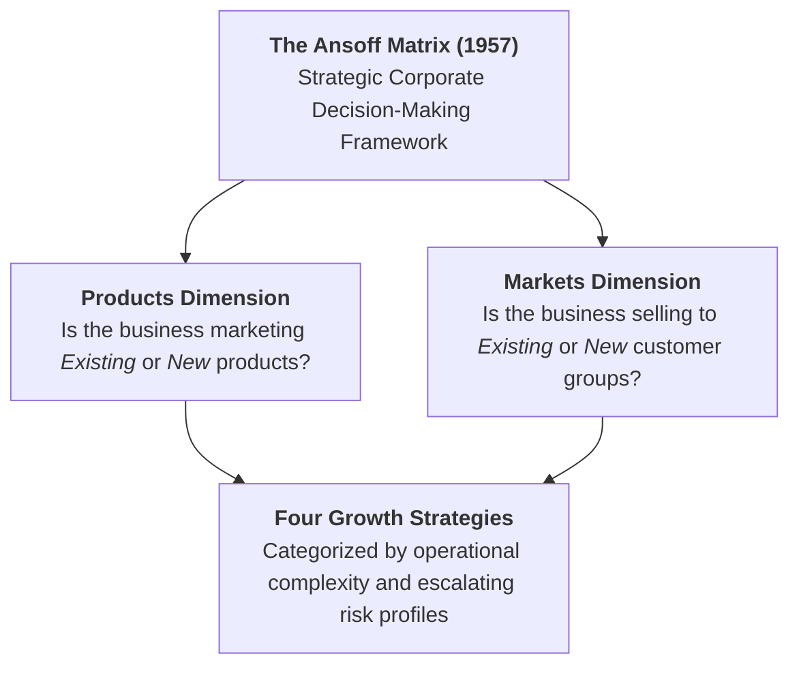
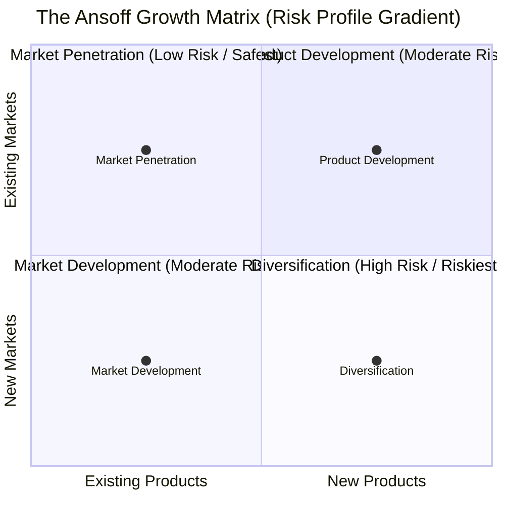
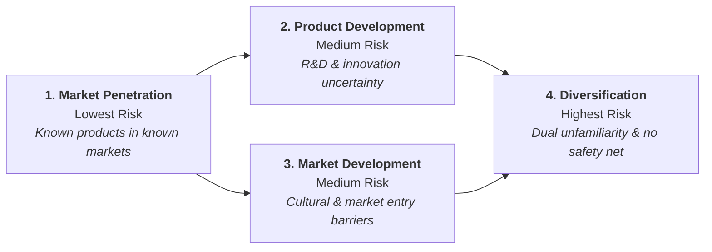
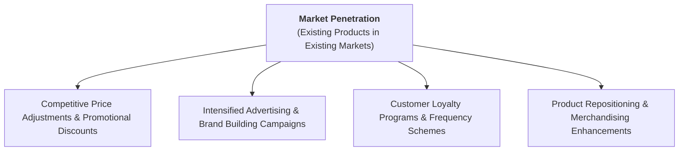
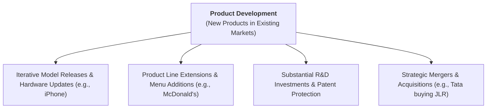
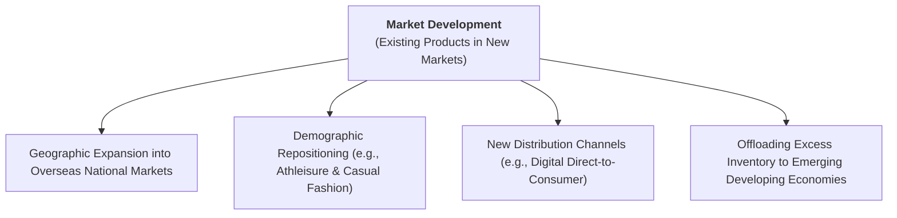
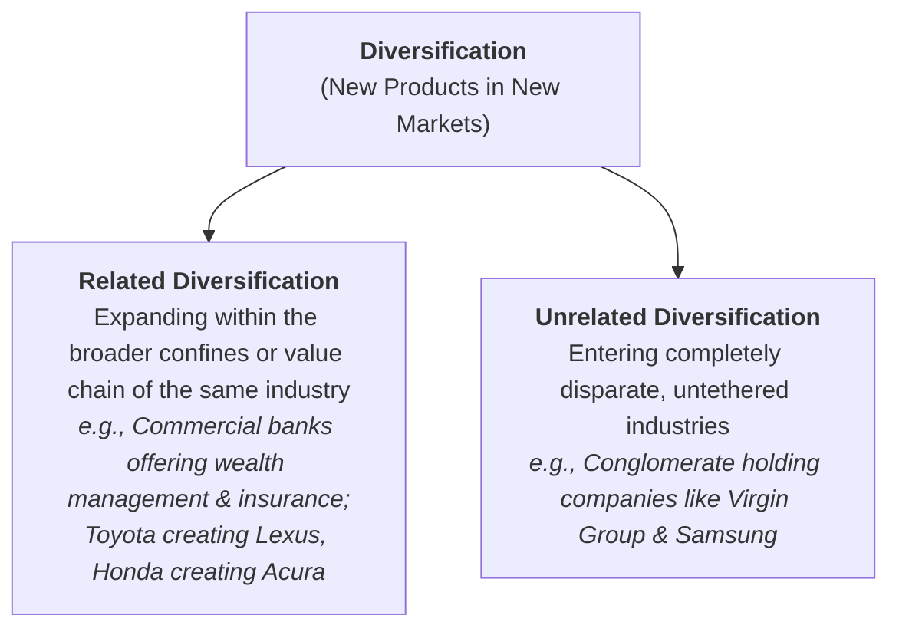
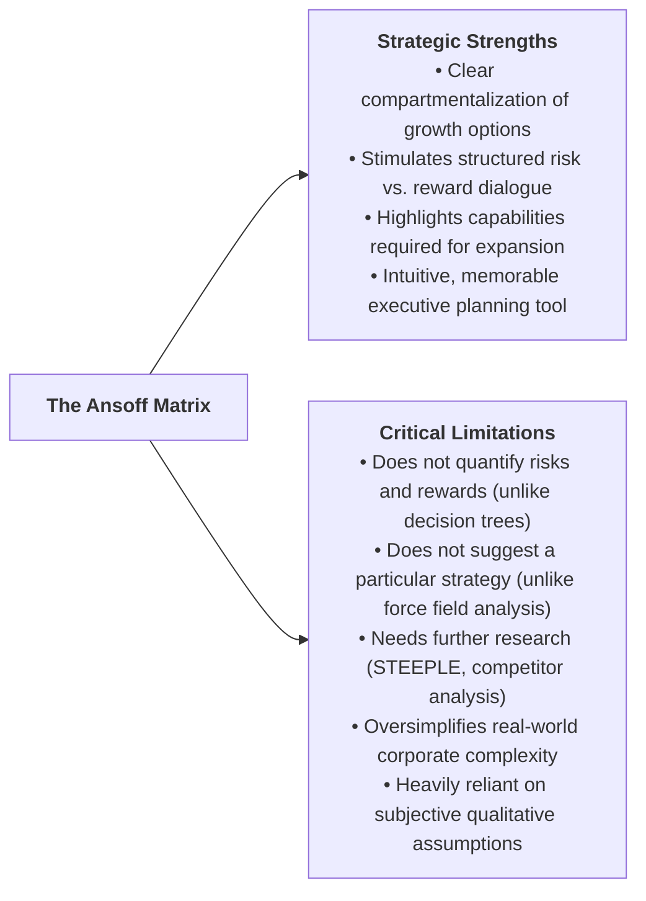

# Business Management Toolkit 2: The Ansoff Matrix

> **IB Business Management | Business Management Toolkit (BMT)**  
> **Tool:** BMT 2 – The Ansoff Matrix (SL/HL Core)

---

## 1. Origin, Definition, and Strategic Role

The **Ansoff Matrix** (1957) is an analytical tool that helps managers to choose and devise various product and market growth strategies. It was devised by **Professor Igor Ansoff** (1918–2002), who showed the growth strategies a firm can take depending on whether it sells new or existing products in new or existing markets (Hoang, Figure 45.1).

### Purpose and Function in Strategic Management

In the IB Business Management curriculum, the Ansoff Matrix is classified as a **decision-making tool**. Its primary functions include:

* **Structuring Growth Options:** Providing executive leaders and entrepreneurs with a logical, four-quadrant model to analyze and choose corporate growth vectors.
* **Evaluating Strategic Risk:** Mapping out the inherent uncertainty and risk profile associated with each strategic option, enabling firms to balance capital outlay against potential failure.
* **Resource and Capability Alignment:** Assisting managers in determining whether corporate expansion requires optimizing existing operational assets or developing entirely new technological and marketing competencies.

---

## 2. The 2x2 Matrix Structure & Risk Gradient

The model maps **Products** (Existing vs. New) along the horizontal axis against **Markets** (Existing vs. New) along the vertical axis, creating four distinct strategic growth pathways:

### The 2x2 Matrix Layout

| | **Existing Products** | **New Products** |
| :---: | :---: | :---: |
| **Existing Markets** | **Market Penetration** *(Low Risk — Safest Option)* | **Product Development** *(Medium / Moderate Risk)* |
| **New Markets** | **Market Development** *(Medium / Moderate Risk)* | **Diversification** *(High Risk — Riskiest Option)* |

### The Ascending Risk Continuum

Risk escalates systematically as a business ventures further from its established knowledge base:

1. **Market Penetration (Lowest Risk):** Operates entirely within known territory—established products sold to familiar customer demographics. Market research and product development expenses are minimized.
2. **Product Development & Market Development (Moderate Risk):** Carry intermediate risk because the firm steps into one dimension of unfamiliarity (either designing an unproven product or navigating an unfamiliar customer segment/region).
3. **Diversification (Highest Risk):** Represents the ultimate corporate gamble. The enterprise must master new product technologies while simultaneously attempting to appeal to unfamiliar customer groups without any preexisting brand equity.

---

## 3. Deep Breakdown of the Four Growth Strategies

---

### Strategy 1: Market Penetration (Existing Products $\times$ Existing Markets)

**Market Penetration** is a growth strategy centered on maximizing sales revenue and market share by selling existing products to existing customer segments.

#### Core Operational Approaches & Tactics
* **Competitive Pricing:** Lowering retail prices (discounting, loss leaders, price matching) to lure price-sensitive customers away from direct rivals.
* **Enhanced Advertising & Promotion:** Launching aggressive marketing blitzes across digital and traditional media to elevate brand recall and encourage heavier usage.
* **Customer Loyalty Schemes:** Rewarding repeat purchases through membership programs, points cards, and exclusive perks (e.g., Starbucks Rewards, airline frequent flyer programs).
* **Brand Repositioning:** Refreshing packaging, visual identity, or retail displays to make the existing product line more appealing to current buyers without modifying its underlying formula.

#### Strategic Advantages
* **Lowest Risk Profile:** Safest of the four strategies because management leverages deep, existing institutional knowledge of customer behavior and market dynamics.
* **Capital Efficiency:** Eliminates expensive R&D, product testing, and new factory tooling costs, keeping market research expenses minimal.
* **Immediate Economies of Scale:** Driving higher production volumes through existing facilities lowers average unit costs ($ATC$).

#### Inherent Limitations & Strategic Risks
* **Aggressive Competitor Retaliation:** Rivals will not surrender market share passively; aggressive price discounting frequently triggers devastating **price wars** that decimate profit margins across the industry.
* **Market Saturation Ceiling:** Once an existing market reaches maturity or saturation, customer acquisition costs soar and incremental growth becomes mathematically impossible, forcing the firm to adopt alternative growth strategies.

---

### Strategy 2: Product Development (New Products $\times$ Existing Markets)

**Product Development** involves creating and launching completely new, modified, or updated products targeted at the firm's established customer base.

#### Core Operational Approaches & Real-World Examples
* **Iterative Upgrades & Annual Product Cycles:**
  * **Apple Inc.:** Apple's launch of the iPhone in 2007 revolutionised the mobile phone industry and propelled profits for the computer manufacturer founded in 1976; it has since released successive iPhone models to its loyal user base.
  * **Automotive Manufacturers:** Car makers frequently launch new vehicle lines, facelifts, electric vehicle ($EV$) conversions, and limited-edition trims to retain existing motorists.
* **Product Line Extensions & Menu Additions:**
  * **McDonald's:** Frequently develops new breakfast sandwiches, seasonal wraps, artisan McCafé beverages, and plant-based burgers (McPlant) to boost average customer spend inside established restaurants.
* **Brand Leveraging:**
  * Globally trusted powerhouses like **Sony** or **Nike** can launch new electronics or apparel items with reduced adoption risk because customers already trust the master brand umbrella.
* **Mergers & Acquisitions (M&A) for Rapid Product Addition:**
  * Product development is also a reason for M&As. Indian automaker **Tata Motors** (founded 1945; India's largest automaker) acquired the UK luxury brands **Jaguar and Land Rover** in 2008, so it could cater for different types of customers without the huge costs and risks of starting a new company.

#### Strategic Advantages
* **Caters to Evolving Customer Demands:** Keeps existing customers engaged, prevents brand fatigue, and defends against competitors who introduce newer technologies.
* **Prolongs the Product Life Cycle:** Functions as a vital **product extension strategy**, revitalizing revenues when legacy product lines enter saturation or decline.
* **High Customer Trust:** Existing customers are predisposed to trial new offerings due to preexisting brand loyalty and familiarity.

#### Inherent Limitations & Strategic Risks
* **Exorbitant R&D and Tooling Costs:** Heavy capital commitments required for design prototypes, engineering validation, patent filing, and promotional rollouts.
* **Risk of Cannibalization:** The new product may capture sales directly from the firm's own profitable legacy products rather than taking share from competitors.
* **Execution Failure:** Introducing an inferior or defective new product into a familiar, competitive market can permanently tarnish the master brand's hard-won reputation.

---

### Strategy 3: Market Development (Existing Products $\times$ New Markets)

**Market Development** is a growth strategy centered on marketing established products to entirely new customer segments or geographic territories.

#### Core Operational Approaches & Real-World Examples
* **Geographic Expansion (Overseas / International Trade):**
  * Opening retail stores, hiring local distributors, or establishing foreign subsidiaries in previously unserved countries.
* **Demographic Targeting & Repositioning:**
  * **Nike and Adidas:** Successfully marketed technical running, tennis, and basketball athletic footwear as high-fashion casual streetwear (*athleisure*), capturing an enormous demographic of non-athletic lifestyle consumers.
* **New Distribution Channels:**
  * **Adidas & E-Commerce:** The COVID-19 pandemic severely disrupted physical retail, prompting Adidas (whose sales revenue fell by 16% in 2020 to €19.84bn) to shift from retail outlets to e-commerce and mail order, with plans to double its e-commerce business to €9bn ($10.2bn) by 2025.
* **Targeting Lower-Income Emerging Markets:**
  * **Nokia:** Smartphones have a short product life cycle in more economically developed countries, where customers upgrade frequently, so Nokia sells its surplus mass-produced smartphones in lower income countries such as Sri Lanka, Indonesia, and Nigeria.

#### Strategic Advantages
* **Product Familiarity:** Management possesses complete technical certainty regarding the product's performance, supply chain, and manufacturing tolerances.
* **Life Cycle Extension Without R&D Outlay:** Extends commercial profitability without requiring redesign, reformulating, or retooling expenses.
* **Diversified Revenue Base:** Shields the company from macroeconomic downturns isolated to its domestic home market.

#### Inherent Limitations & High-Profile Corporate Failures

Entering an unfamiliar market carries severe operational, cultural, and competitive risks:

* **Target in Canada (closures in 2015):**
  * U.S. retail giant Target closed more than 130 stores in Canada in 2015, citing cultural differences as the reason.
* **Carrefour's Retreat from Southeast Asia (late 2010):**
  * French retailing giant Carrefour pulled out of Thailand, Malaysia, and Singapore after failing to establish a market presence.
* **Google in China:**
  * Google struggled to establish itself in China, where the local company **Baidu** maintains around 85% market share.

---

### Strategy 4: Diversification (New Products $\times$ New Markets)

**Diversification** is the sale of entirely new products in completely new, untapped markets. It represents the boldest, most radical, and **highest-risk** growth option in strategic management.

#### The Two Dimensions of Diversification

##### 1. Related Diversification
* **Definition:** Catering for new customers within the broader confines of the same industry.
* **Risk Profile:** Less risky than unrelated diversification, because it builds on the firm's product and market knowledge (Hoang p.613).
* **Examples:**
  * **Financial Institutions:** Commercial retail banks diversifying into wealth management, private banking, commercial mortgages, and insurance policies.
  * **Automotive Luxury Tiers:** Mainstream Japanese car manufacturers successfully launching dedicated upmarket luxury automotive brands to capture affluent motorists: **Toyota $\rightarrow$ Lexus**, **Nissan $\rightarrow$ Infiniti**, and **Honda $\rightarrow$ Acura**.

##### 2. Unrelated Diversification (Conglomerate Integration)
* **Definition:** Selling completely new products in untapped markets.
* **Risk Profile:** Diversification is the riskiest of the four growth options because the business is not operating in familiar territory.
* **The Holding Company / Conglomerate Model:**
  * A **holding company (or parent company)** owns controlling shareholdings in a diverse portfolio of subsidiary operating companies across different global industries.
  * **WarnerMedia (Holding Company):** Controls a sprawling empire of entertainment subsidiaries, including Warner Bros, Cinemax, DC Comics, CNN, HBO, and Cartoon Network.
  * **Virgin Group Ltd. (Case study 45.2):** a UK multinational conglomerate co-founded by Sir Richard Branson and Nik Powell in 1970, operating in healthcare, travel, media, entertainment, hospitality, retail, telecommunications, banking, motorsport, cruise line, charity and even aerospace.
  * **Samsung:** consumer electronics, shipbuilding, construction, retail, chemicals and insurance.
  * **Honda:** besides cars (and the related Acura brand), Honda produces lawnmowers and airplanes.

#### Rationale for Pursuing Diversification
* **Risk Spreading:** The key driving force is to spread risks through a well-balanced product portfolio, so that a downturn in one sector is cushioned by another.
* **Escape from Saturated Markets:** Diversification suits businesses that have reached saturation and seek new growth opportunities.

#### High-Profile Failures & Diversification Disasters

Diversification remains the riskiest of the four growth options. Textbook examples (Hoang p.613):

* **Harley-Davidson (1990s):**
  * The motorcycle maker diversified into the fragrance industry, which caused much offence to its loyal customer base.
* **Next (2010):**
  * The UK clothing retailer failed to establish itself in the tablet computers market.
* **Virgin Cola:**
  * Virgin Group tried to take on Coca-Cola and Pepsi with Virgin Cola, but captured only a 3% market share in the UK.
* **Loss of Focus and New Channels:** New distribution channels have to be established, which is time consuming and costly, and such distractions can make an organization lose focus on its core business.

---

## 4. Comprehensive Comparison Table of Ansoff Strategies

Below is the definitive syllabus comparison matrix synthesizing the four growth strategies (aligned with Paul Hoang Table 45.1 and IB assessment criteria):

| Strategic Dimension | Market Penetration | Product Development | Market Development | Diversification |
| :--- | :--- | :--- | :--- | :--- |
| **Product Type** | **Existing** Products | **New** Products | **Existing** Products | **New** Products |
| **Target Market** | **Existing** Customers | **Existing** Customers | **New** Customer Groups | **New** Customer Groups |
| **Relative Risk Level** | **Lowest Risk (Safest)** | **Moderate / Medium Risk** | **Moderate / Medium Risk** | **Highest Risk (Riskiest)** |
| **Primary Corporate Goal** | Protect or expand market share in known territory | Innovate to replace maturing products; deepen customer wallet share | Exploit geographic expansion or unlock new demographic segments | Spread risk across diverse industries; overcome market saturation |
| **Key Operational Drivers** | Competitive pricing, loyalty rewards, heavy promotions, brand repositioning | High R&D expenditure, prototype testing, product extension, brand equity | Export licensing, local distributor partnerships, cultural adaptation, digital channels | Mergers & acquisitions, holding company governance, autonomous business units |
| **Competitive Dynamics** | Fierce rivalry; high threat of retaliatory **price wars** | Threat of customer resistance or self-cannibalization | Threat from entrenched domestic rivals and foreign regulatory hurdles | Operating without core competencies; severe risk of managerial distraction |

---

## 5. Critical Evaluation of the Ansoff Matrix

To attain maximum marks in IB evaluative essays (AO3 Analysis and Evaluation), students must understand both the strategic utility and the structural shortcomings of the Ansoff Matrix.

### Strategic Strengths & Advantages

1. **Structured Compartmentalization:**
   * It provides senior executives and board members with a clean, disciplined framework to categorize strategic growth vectors rather than pursuing ad-hoc expansion.
2. **Prompts Rigorous Risk Assessment:**
   * By framing growth choices around unfamiliarity, it compels decision-makers to evaluate whether the business possesses the risk tolerance, cash reserves, and organizational capabilities to execute the strategy.
3. **Facilitates Executive Consensus:**
   * It serves as a visual catalyst during strategic retreats, helping diverse stakeholders align on corporate priorities and resource allocation.

### Inherent Limitations & Analytical Deficiencies

1. **Absence of Quantitative Modeling:**
   * Unlike decision trees, the matrix does not quantify the risks and rewards of each strategy (no probabilities, return on investment or payback periods). It treats risk purely as a qualitative concept.
2. **Does Not Prescribe a Specific Decision:**
   * Unlike force field analysis, the Ansoff Matrix does not prescribe a strategy: it cannot tell a board of directors *which* of the four options to finance. The final choice remains entirely dependent on managerial intuition and external research.
3. **Needs Further Research and Data:**
   * A choice made with the matrix needs further investigation. For example, market development requires research into the challenges of entering new markets (especially overseas) and competitor analysis to judge how existing firms will react; diversification carries even more risk. The textbook suggests using Ansoff alongside SWOT and STEEPLE.
4. **Neglects Competitor Dynamics:**
   * The matrix itself does not show how rivals will react when a firm launches a new product or enters their market, which is why competitor analysis is needed.
5. **Real-World Firms Pursue Multiple Strategies Concurrently:**
   * In reality, firms are not limited to a single growth strategy. Large multinationals competing in highly contestable markets use multiple strategies at once to grow, evolve and remain competitive.

> [!IMPORTANT]
> **Syllabus Integration:** The Ansoff Matrix is most effective when deployed as part of an integrated toolkit. Decision-makers should combine it with **SWOT Analysis** (to audit internal capabilities), **STEEPLE Analysis** (to evaluate external market conditions), and **Decision Trees / Investment Appraisal** (to quantify financial risk and projected returns).

---

## 6. IB Exam Practice & Application Guide

When answering IB examination questions on the Ansoff Matrix, students should adhere to the following best-practice protocols:

* **Identify the Starting Baseline:** In any case study stimulus, always identify what the business *currently* manufactures and to whom it *currently* sells before evaluating a proposed expansion.
* **Distinguish Between Related and Unrelated Diversification:** If an exam question asks about Diversification, distinguish whether the business is expanding into an adjacent value-chain sector (Related) or a completely disconnected industry (Unrelated). This nuance demonstrates superior subject mastery.
* **Highlight Risk-Adjusted Resource Allocation:** Never recommend Diversification without explicitly addressing the company's financial liquidity, debt gearing, and whether management has the bandwidth to manage an unfamiliar enterprise.
